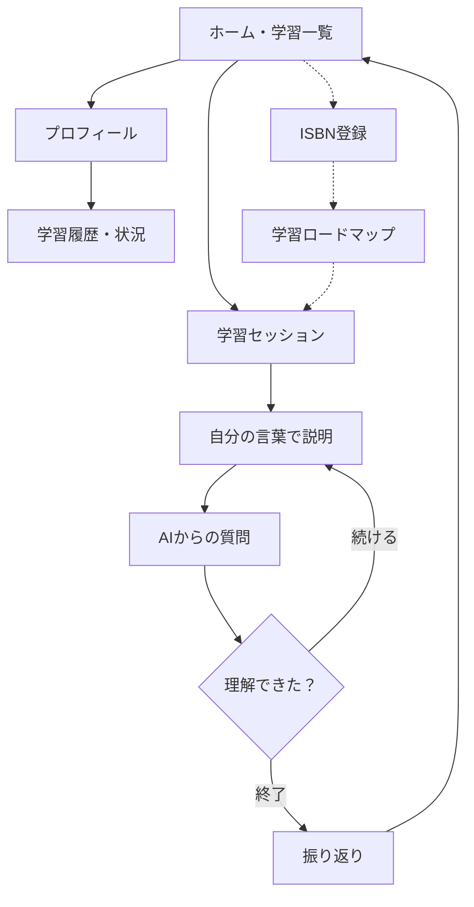

# AIに教える

## 概要

学んだ内容を、何も知らない AI に自分の言葉で説明する学習アプリ。AI は答えを教えず、説明の中身について質問を返してくる。自分が「理解できた」と思えるまで説明と質問を繰り返し、学んだことを自分の言葉で説明できる力にする。

最初の版は、教材の PDF・txt を読み込ませ、文字入力で AI に説明する。AI は教材の中身を口に出さず、教材にあって説明に無い点を「〜ってどういうこと？」と知らないふりで聞く。

- カテゴリ: 教育

## アプリの利点（purpose）

- 人に教えるように説明することで、「わかったつもり」に気づける
- 友だちの時間を奪わずに、いつでも「教える相手」がいる
- 一人では続きにくい振り返りを、AI と一緒に続けやすくする
- AI が答えを出すのではなく、自分の言葉で説明する。ハッカソンのテーマ "Own the Why" とも合う

## ペルソナ・ターゲット

ターゲット: 教科書・参考書・授業で勉強している学生（高校生・大学生）

ペルソナ（案）:
- 大学1年生。授業の資料や資格の参考書で勉強している
- 一人で復習すると、読んだだけで「わかったつもり」になってしまう
- 友だちに説明を聞いてもらうのは、相手の時間を取るので気が引ける
- 一人だと勉強が続かず、途中でやめてしまうことが多い

## どのデバイスで使う

- PC・スマホのブラウザで使う Web アプリ
- 最初の版は文字入力とファイルの読み込みなので、どちらでも使える

## 使用技術

- 画面: React + TypeScript + Vite（Firebase Hosting で公開）
- API: Go（Cloud Run で公開）
- 生成 AI: Gemini（Flash 系）。本番は Vertex AI 経由（案）。教材の PDF もそのまま渡せる
- データ保存: 最初はブラウザ内。ログインや複数端末が必要になったら Firestore

## 担当

- リーダー・デザイン: Figma、全体の進行
- バックエンド: Gemini との対話、Cloud Run、教材の PDF・txt の読み込みと保存（分担案）
- フロントエンド: 画面の実装

## 画面構成

1. ホーム・学習一覧: 学習を始める、過去の学習を見る
2. 学習セッション: テーマを入力し、教材の PDF・txt を読み込ませる
3. 説明と質問: 自分の言葉で説明を書く、AI の質問を表示する、「理解できた」ボタン
4. 振り返り: 教えた内容の要約、説明しきれなかった点（案）
5. プロフィール
6. 学習履歴・状況

後回し: ISBN 登録、学習ロードマップ

## 画面遷移

点線は後回しの部分。

## 基本機能案（MVP）

- テーマを入力し、教材の PDF・txt を読み込ませる
- 何も知らない AI に、自分の言葉で説明する（文字入力）
- AI は教材の知識を出さず、説明の中身について質問を1つずつ返す。教材にあって説明に無い点は、知らないふりで聞く
- 自分が「理解できた」と思うまで繰り返し、終了で終える
- 振り返りを保存し、学習一覧と学習履歴で見返せる

## ユーザーフロー

1. ホームを開く
2. 学習セッションを始め、テーマを入力して教材の PDF・txt を読み込ませる
3. 学んだ内容を、自分の言葉で書いて AI に説明する
4. AI が説明の中身について質問を返す
5. 質問に答える、説明を足す（納得するまで繰り返す）
6. 「理解できた」を押して終える
7. 振り返りを見て、ホームに戻る
8. プロフィールから、学習履歴と状況を見る

## 追加機能案

- 声で説明する（文字に起こして AI に渡す）
- 教科書・参考書のバーコード（ISBN）で教材を登録し、AI が単元のロードマップを作る
- 教えた内容が「箱」に溜まって見える（知識の箱）
- 経験値とレベル、連続記録（ストリーク）、GitHub の草のような学習記録
- 教材から AI が問題を作る
- AI のキャラクターを選べる（弟・後輩・赤ちゃん・空の箱）
- Google ログインと、複数端末での保存（Firestore）
